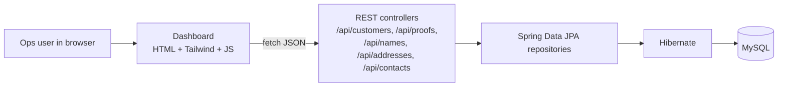

# finwar

**A customer onboarding and KYC records service for a bank or fintech.** It stores who a customer is: their identity documents, names, addresses and contact details, each with the date it took effect. Built with Spring Boot, JPA and MySQL, with a small web dashboard for operations staff.

I built it for the FinTech Lab course at MIT Manipal (Jan to Apr 2025). The project began as a data-modelling exercise: design the customer master tables a bank keeps. It then grew into a working REST service with a front end on top.

---

## The problem

Every regulated financial product starts with the same step: **know your customer**. Before an account is opened or a loan is approved, the institution must record who the customer is and prove it. In India that proof is usually Aadhaar, PAN or a passport, along with an address and contact details.

In practice this data is messy:

- **One customer, many records.** A person has a legal name, a known-as name, several addresses (home, office, correspondence) and several phone numbers and emails. Put all of that in one wide "customer" row and you lose information.
- **History matters.** Regulators and auditors ask what was true *on a given date*. An address change shouldn't overwrite the old address without a record.
- **Identity documents expire.** A passport has a start date and an end date. KYC has to be re-done when a document lapses, so the system has to know those dates.

## Who it's for

| User | What they need |
|---|---|
| **Onboarding / operations staff** at a bank, NBFC or fintech | One place to enter and look up a customer's KYC details |
| **Compliance teams** | Effective-dated records they can audit, and document validity dates |
| **Developers of downstream products** (loans, cards, payments) | A clean REST API for the customer master, instead of each product keeping its own copy |

## What it does

- **Customer profile:** type (individual or entity), full name, date of birth, status, contact number, email, country of origin and effective date.
- **Proof of identity:** document type (Aadhaar, PAN, passport and so on), document number, validity start and end dates.
- **Name components:** first, middle and last names, stored as separate typed rows.
- **Addresses:** typed (home, office and so on) with city, state, PIN code and country.
- **Contacts:** typed phone numbers and emails.
- **Dashboard:** one page per record type, with add, list, search-as-you-type and delete.

## By the numbers

Only facts from the code. This is a course project; it has had no real users.

| | |
|---|---|
| Domain entities (JPA) | 5 |
| REST endpoints | 15 (list, create and delete for each entity) |
| Web pages | 7 (redirect page, dashboard, 5 record screens) |
| Java code | about 420 lines |
| Front end (HTML/JS/CSS) | about 2,150 lines |
| Tables in the original ERD design | 6 ([docs/erd-design.sql](docs/erd-design.sql)) |
| Automated tests | 3, all passing (run against an in-memory database) |

## How it works



1. The dashboard is static HTML/JS served by Spring Boot itself (`src/main/resources/static`). There is no separate front-end build.
2. Each screen calls a REST controller with `fetch`. Controllers are thin: they pass the request straight to a Spring Data repository.
3. **The data model is the core design choice.** `CustomerDetails` is the anchor record. Names, addresses, contacts and identity proofs are separate tables that each point back to it (`@ManyToOne` on `customer_id`). One customer can therefore hold any number of each, and every row carries an `effectiveDate`.
4. Hibernate creates the tables from the entities on first run (`ddl-auto=update`), so a fresh MySQL needs no hand-written schema.

### The data model, and how it was designed

The first design, in [docs/erd-design.sql](docs/erd-design.sql), follows the pattern banks use for a customer master:

- A **classification lookup table** (`Customer_Classification`) holds every "type" value, such as name component, address component and ID document type. New types can be added without schema changes.
- **Name and address components** are stored one per row (`first`, `middle`, `last`; `line1`, `city`, `PIN` and so on), keyed by customer plus component type.
- **Audit columns** on the lookup table: who changed it, from which workstation and program, with host, local and accepted timestamps, a UUID and a CRUD flag.

The Spring Boot app keeps the same entity split and effective dating. It simplifies the rest to ship a working API: plain typed string columns instead of the lookup table, and no audit columns. That gap is listed under limitations.

## Tech stack

- **Backend:** Java 17, Spring Boot 3.4 (Web, Data JPA), Hibernate
- **Database:** MySQL 8 (H2 in-memory for tests)
- **Front end:** plain HTML and JavaScript, Tailwind CSS (CDN), Font Awesome
- **Build:** Maven (wrapper included)

## What I learned

- **Modelling is the product.** The hardest calls were which tables to have and what history to keep, not the code. One-row-per-component with effective dates is more work than one wide table. It is also the only design that answers an auditor's "what was this customer's address in March?"
- **Normalised designs cost speed.** My ERD's lookup-table design was more flexible, but every form needed extra joins and ID mapping. For the app I traded some of that flexibility for typed string columns so the API could ship. In a real product that would be a decision to make with the compliance team, not alone.
- **Contract drift between front end and back end is real.** I built the screens and the API separately, and four of the five screens drifted from the API's URLs and field names (see limitations). An agreed API contract, such as an OpenAPI spec, plus a test per endpoint would have caught this on day one. That is why this repo now has API tests.

## How I'd measure impact (if deployed)

This hasn't been deployed or used, so these are the metrics I would track, not results:

| Metric | Why it matters |
|---|---|
| Median time to complete one customer's KYC entry | The main efficiency goal for ops staff |
| % of customer records with a complete KYC set (ID + address + contact) | Data completeness for compliance |
| Number of active customers with an ID document expiring in the next 30 days | Drives re-KYC work before it becomes a breach |
| Duplicate-customer rate (same PAN on two customer records) | Data quality |
| API error rate and p95 latency | Reliability for downstream products |

## Limitations (honest)

- **Only the Customer Details screen is wired end to end.** The Names, Proofs, Contacts and Addresses screens call `/api/customer-names`, `/api/customer-proofs` and so on, with flat fields like `firstName` and `customerId`. The API serves `/api/names`, `/api/proofs` and so on, and expects `nameType` and `nameValue` plus a nested `customer` object. Those four screens' API endpoints work and are tested, but the screens don't save yet.
- **No authentication or authorisation.** Anyone who can reach the server can read or delete KYC data, and CORS is open (`*`). This is unacceptable for real personal data.
- **No input validation.** PAN, Aadhaar, PIN code and email formats aren't checked, and there's no check against duplicate customers.
- **No update endpoint.** Records can be created and deleted but not edited. A delete is a hard delete, which loses the history the data model was designed to keep.
- **Sensitive data isn't protected.** ID numbers are stored in plain text, with no masking in the UI and no encryption at rest.
- **No audit trail in the app.** The audit columns exist only in the ERD design, not in the running service.
- **Not deployed.** There is no live link; it runs locally.

## Future scope

1. **Fix the four screens** to match the API contract, and add an OpenAPI spec so the two can't drift again.
2. **Real KYC rules:** format validation for PAN, Aadhaar and PIN; duplicate detection on ID number; and a re-KYC queue for documents nearing their end date.
3. **Soft deletes and full history:** replace hard deletes with end-dating, plus the audit columns from the ERD.
4. **Security:** login with roles (maker and checker), masked ID numbers in the UI, and encryption at rest for document numbers.
5. **AI-assisted onboarding (exploratory).** Use document OCR with an LLM to read an uploaded PAN card or passport and pre-fill the form, with a human confirming every field. Success would be measured as time saved per customer and the field-level correction rate. Nothing like this exists in the code today.

## Run it locally

**Requirements:** JDK 17 or later and MySQL 8 running locally. Maven isn't needed because the wrapper is included.

1. Set your database credentials as environment variables. The app creates a database called `finwar` on first run:

   ```bash
   export DB_USERNAME=root
   export DB_PASSWORD=your-mysql-password
   ```

   On Windows PowerShell: `$env:DB_USERNAME="root"; $env:DB_PASSWORD="your-mysql-password"`. All options are listed in [`application.properties.example`](src/main/resources/application.properties.example).

2. Start the app:

   ```bash
   ./mvnw spring-boot:run
   ```

3. Open <http://localhost:8080> for the dashboard.

**Run the tests** (no MySQL needed, because they use an in-memory H2 database):

```bash
./mvnw test
```

**Try the API directly:**

```bash
curl -X POST localhost:8080/api/customers -H "Content-Type: application/json" \
  -d '{"customerType":"Individual","fullName":"Asha Rao","status":"Active","email":"asha@example.com"}'

curl -X POST localhost:8080/api/proofs -H "Content-Type: application/json" \
  -d '{"idType":"PAN","idValue":"ABCDE1234F","startDate":"2025-01-01","customer":{"id":1}}'

curl localhost:8080/api/proofs
```

## Project layout

```
src/main/java/com/example/customerapp/
  entity/        5 JPA entities (CustomerDetails + 4 linked KYC record types)
  repository/    Spring Data JPA repositories
  controller/    REST controllers, list / create / delete each
src/main/resources/
  static/        dashboard and record screens (HTML + JS)
  application.properties   config; credentials come from environment variables
src/test/        API tests against in-memory H2
docs/erd-design.sql        the original normalised ERD with sample data and queries
```
